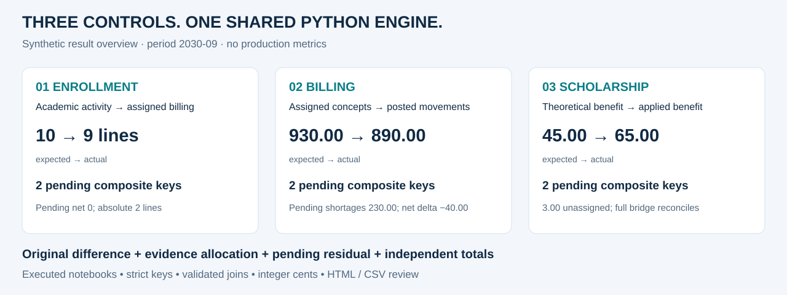
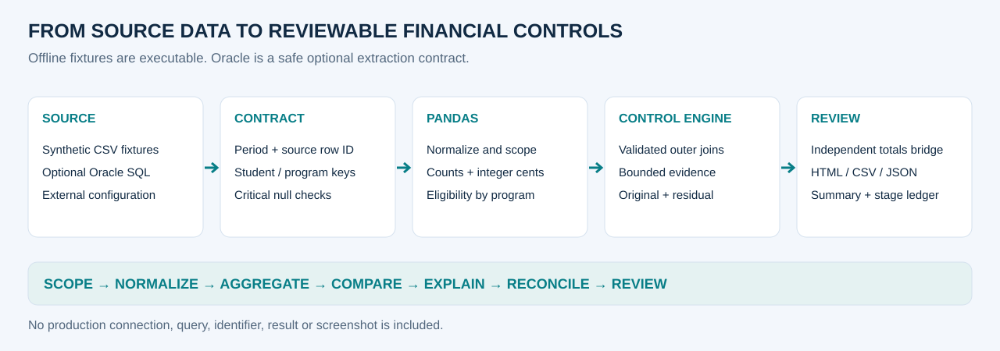
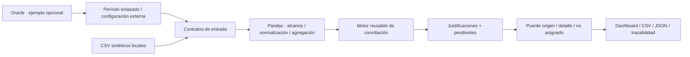

# Controles financieros · Python, Pandas y Oracle SQL

[English](README.md) · [Recorrido de un minuto](docs/portfolio_walkthrough.es.md) · [Profundización técnica](docs/interview_deep_dive.es.md)

**En mi trabajo actual en una universidad desarrollo y utilizo tres controles financieros con Python, Pandas y Jupyter sobre datos autorizados de Oracle.** Comparan inscripciones con conceptos asignados a facturación, conceptos asignados con movimientos facturados y beca teórica con beca aplicada.

Los uso para detectar registros faltantes o de más, comparar cantidades e importes, aplicar
justificaciones de negocio e identificar diferencias que necesitan revisión. Este proyecto
público reconstruye esos flujos de forma sanitizada y reproducible, con datos y reglas
inventados; los registros operativos y la configuración privada quedan fuera del repositorio.

## Perfil técnico demostrado

| Capacidad | Cómo la aplico | Evidencia en este proyecto |
|---|---|---|
| **Python · Pandas · Jupyter** | Transformar datos operativos, conciliar fuentes independientes y preparar excepciones para revisión. | [Tres notebooks ejecutados](notebooks/) · [Adaptadores de control](src/financial_controls/controls.py) |
| **Oracle SQL** | Extraer datos autorizados y preparar universos mediante joins, filtros y agregaciones. | [Ejemplo de preparación SQL](sql/01_composite_reconciliation.sql) · [Contrato de extracción configurable](examples/oracle_connection.py) |
| **Modelado y joins** | Definir grano y claves compuestas; validar resúmenes uno-a-uno y reglas muchos-a-uno. | [Contratos de entrada](src/financial_controls/contracts.py) · [Motor compartido](src/financial_controls/reconciliation.py) |
| **Calidad de datos financieros** | Tratar centavos, diferencias firmadas, excepciones, evidencia y cuadre de origen contra detalle. | [Política monetaria](src/financial_controls/money.py) · [Matriz de controles](docs/control_matrix.md) |
| **Entrega mantenible** | Separar módulos, probar fallas, trazar etapas, externalizar configuración y exportar reportes de revisión. | [Tests](tests/test_financial_controls.py) · [Trazas](src/financial_controls/trace.py) · [Reportes](src/financial_controls/reporting.py) |



## Tres controles, un motor compartido

| Caso de estudio | Qué verifica | Un resultado que merece revisión |
|---|---|---|
| **[01 · Inscripciones → asignado a facturación](docs/cases/01_enrollment.es.md)** | Consistencia entre actividad académica y preparación de facturación | 10 líneas de inscripción frente a 9 asignadas; los excesos y faltantes permanecen visibles |
| **[02 · Asignado → movimientos facturados](docs/cases/02_billing.es.md)** | Integridad de cantidades e importes facturados | Ambas fuentes tienen 9 líneas, pero difieren en −40,00 y quedan dos casos por clave pendientes |
| **[03 · Beca teórica → beca aplicada](docs/cases/03_scholarship.es.md)** | Aplicación y atribución del beneficio | 45,00 teóricos frente a 65,00 aplicados; 3,00 no tienen carrera y no deben duplicarse |

Cada caso tiene página bilingüe, notebook ejecutado, vista de resultados y exportaciones
para revisión. Los resultados de ejemplo corresponden a las fixtures públicas sintéticas.

## Arquitectura de punta a punta





La ejecución predeterminada es local. La [plantilla Oracle](examples/oracle_connection.py)
no conecta al importarse, usa configuración externa y parámetros enlazados, y consulta vistas
ficticias. Es un contrato de integración de ejemplo, no un despliegue validado.

## Matriz comparativa de controles

| Control | Objetivo | Grano / clave tras filtrar período | Relación esperada | Regla principal | Excepciones | Salida de revisión |
|---|---|---|---|---|---|---|
| Inscripciones | Explicar cantidades asignadas frente a inscriptas | Alumno + carrera | 1:1 entre resúmenes | Líneas reales − esperadas | Contado; no aranceladas; cuotas previas | Dirección, evidencia consumida y líneas pendientes |
| Facturación | Conciliar asignado con movimientos facturados | Alumno + carrera | 1:1 entre resúmenes | Cantidades **e** importes a centavos | Ajustes manuales sintéticos; evidencia parcial | Pendientes monetarios y de líneas, netos y absolutos |
| Becas | Conciliar aplicado con elegibilidad teórica | Alumno + carrera; reglas por carrera | 1:1 entre universos; muchos:1 con reglas | Mínimo y tasa explícitos sobre base facturada | Asignaciones sintéticas; aplicado sin base; falta de carrera | Teórico, aplicado, justificado y registro no asignado |

Los dos primeros notebooks profesionales agrupaban por alumno: la clave compuesta pública
es una mejora deliberada. El notebook de becas ya demostraba claves compuestas y cardinalidad
validada. Ninguna regla ficticia se presenta como política institucional.

## Decisiones técnicas demostradas

- **Contratos antes de comparar:** IDs de fila únicos, claves obligatorias, período explícito y campos Y/N estrictos.
- **Identificadores estables:** texto normalizado sin perder ceros iniciales; nulos críticos rechazados.
- **Cardinalidad como control:** cruces outer validados y consulta de reglas muchos-a-uno.
- **Política monetaria:** ingreso decimal, redondeo half-up, centavos enteros, signos y tolerancia explícitos.
- **Dos estados:** `OK / DE MÁS / DE MENOS` matemáticos separados de `JUSTIFICADO / PENDIENTE`.
- **Registro de asignaciones:** cada evidencia se consume una vez y hasta el remanente disponible.
- **Conservación:** real − esperado = detalle por clave + importe explícitamente no asignado.
- **Etapas trazables:** cantidades de entrada, exclusiones de alcance, agrupación, joins, evidencias y cuadre; logging opcional de metadatos.

El puente de totales puede conciliar y aun así dejar casos pendientes. Becas demuestra
esa diferencia en lugar de mostrar un resultado general engañosamente verde.

## Reproducir y revisar

Python 3.11 o superior, desde la raíz:

```powershell
python -m venv .venv
.venv/Scripts/Activate.ps1
python -m pip install -e ".[dev,notebooks]"
python -m pytest -q
python -m financial_controls.demo --period 2030-09 --output artifacts --verbose
python scripts/run_notebooks.py
python scripts/build_portfolio_assets.py
python scripts/check_links.py
python scripts/scan_public.py
```

Los tres [notebooks](notebooks/) incluyen **outputs sintéticos ejecutados** y se pueden leer
sin iniciar un kernel. El runner genera copias desde kernels nuevos en artifacts; `--publish`
actualiza los notebooks públicos tras validar los datos ficticios.
Abrir `artifacts/<caso>/report.html` localmente para ver el dashboard completo.

Cada caso exporta `detail.csv`, `summary.csv`, `allocations.csv`, `unassigned.csv`,
`trace.csv`, `kpis.json` y `report.html`. Las columnas monetarias CSV están en centavos.
Las [muestras versionadas](docs/outputs/) y los diagramas se regeneran desde las mismas fixtures.

## Calidad, confidencialidad y límites

Las pruebas incluyen duplicados de eventos/configuración, claves nulas, tipos inválidos,
centavos, diferencias sólo de cantidad, direcciones contradictorias, justificaciones
parciales, becas no asignadas, identidades de conciliación y trazabilidad sin datos personales.
CI también ejecuta notebooks, revisa enlaces y escanea texto público. [Validación](docs/validation.md).

No se distribuyen notebooks, consultas, conexiones, identificadores, resultados ni capturas
productivos. Las nuevas filas, reglas, tasas e importes son inventados. El mínimo de dos
materias y la tasa de 10% son políticas de demostración.
Ver [seguridad](docs/security.md), [reglas](docs/business_rules.md) y [límites](docs/limitations.md).

## Evidencia del trabajo real vs demostración pública sintética

| Observado en los notebooks profesionales | Reconstrucción pública / ingeniería adicional |
|---|---|
| Extracción Oracle, Pandas, agrupaciones, merges y excepciones | Fixtures locales y contrato Oracle sin efectos al importar |
| Cantidades académicas y conciliación asignado/facturado | Tres casos específicos con un motor compartido |
| Beca teórica/aplicada, clave compuesta y cardinalidad | Elegibilidad ficticia configurable y registro no asignado |
| Totales madre/detalle, HTML y una exportación Excel | Puente independiente, asignaciones, resumen, trazas y exportaciones |
| Código y salidas de ejecuciones guardadas | Tests, kernels nuevos y evidencia visual pública reproducible |

La revisión estática no certificó exactitud productiva, frecuencia, escala ni impacto.
No se afirma migración completa, histórico productivo, ejecución programada, ahorro medido
ni seniority de liderazgo.

## Elegir el nivel de lectura

- [Recorrido para recruiters](docs/portfolio_walkthrough.es.md): alcance y tres ejemplos en un minuto.
- [Profundización para entrevistas](docs/interview_deep_dive.es.md): claves, dinero, evidencia y límites.
- [Arquitectura](docs/architecture.md) · [Diccionario](docs/synthetic_data_dictionary.md) · [Matriz de controles](docs/control_matrix.md).
- [Resumen profesional](docs/professional_summary.md): textos defendibles con esta evidencia.

## Evolución del proceso anterior

ACL Analytics fue la herramienta anterior y el origen del conocimiento de control. Scripts,
capturas y el ejemplo genérico previo se conservan en [legacy/](legacy/README.md) como archivo
histórico, fuera del recorrido principal del portfolio.
