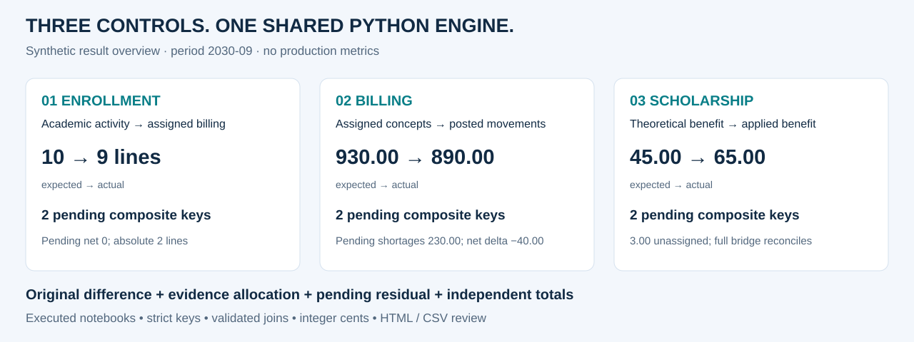
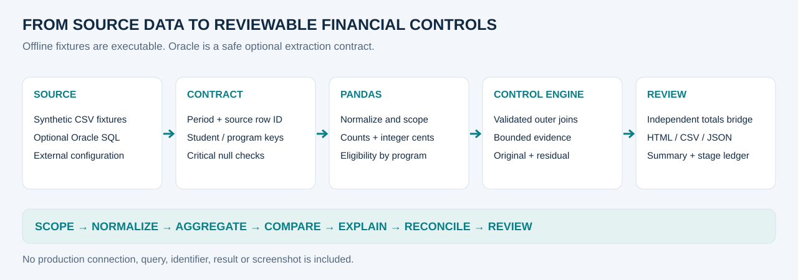
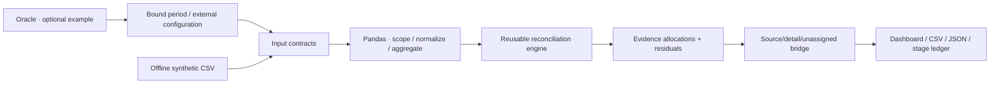

# Financial controls · Python, Pandas & Oracle SQL

[Español](README.es.md) · [60-second walkthrough](docs/portfolio_walkthrough.md) · [Technical deep dive](docs/interview_deep_dive.md)

**In my current work at a university, I develop and use three financial controls with Python, Pandas and Jupyter over authorized Oracle data.** They compare enrollment with assigned billing, assigned concepts with billed movements, and theoretical scholarships with applied benefits.

I use these controls to detect missing or extra records, compare quantities and amounts,
apply business explanations and identify differences that need review. This public project
reconstructs those workflows in a sanitized, reproducible form with invented data and rules;
operational records and private configuration stay outside the repository.

## Technical profile demonstrated

| Capability | How it is applied | Evidence in this project |
|---|---|---|
| **Python · Pandas · Jupyter** | Transform operational datasets, reconcile independent sources and make exceptions reviewable. | [Three executed notebooks](notebooks/) · [Control adapters](src/financial_controls/controls.py) |
| **Oracle SQL** | Extract authorized data and prepare reconciliation universes through joins, filters and aggregations. | [SQL preparation example](sql/01_composite_reconciliation.sql) · [Configurable extraction contract](examples/oracle_connection.py) |
| **Data modeling and joins** | Define grain and composite keys; validate one-to-one summaries and many-to-one rule lookups. | [Input contracts](src/financial_controls/contracts.py) · [Shared reconciliation engine](src/financial_controls/reconciliation.py) |
| **Financial data quality** | Handle cents, signed differences, business exceptions, evidence allocations and source/detail totals. | [Monetary policy](src/financial_controls/money.py) · [Control matrix](docs/control_matrix.md) |
| **Maintainable delivery** | Separate modules, test failure cases, trace stages, keep configuration external and export review reports. | [Tests](tests/test_financial_controls.py) · [Stage trace](src/financial_controls/trace.py) · [Reporting](src/financial_controls/reporting.py) |



## Three controls, one control engine

| Case study | What it protects | A result worth investigating |
|---|---|---|
| **[01 · Enrollment → assigned billing](docs/cases/01_enrollment.md)** | Consistency between academic activity and billing preparation | 10 enrollment lines vs 9 assigned lines; both extra and missing assignments remain visible |
| **[02 · Assigned → posted billing](docs/cases/02_billing.md)** | Completeness and accuracy of posted billing | Both sources have 9 lines, yet the amount differs by −40.00 and two keyed cases remain pending |
| **[03 · Expected → applied scholarship](docs/cases/03_scholarship.md)** | Correct benefit application and attribution | 45.00 expected vs 65.00 applied; 3.00 lacks a program and must not be duplicated |

Each case includes a bilingual study, an executed notebook, a generated result snapshot and
review exports. The example outcomes use the public synthetic fixtures.

## End-to-end design





The default path is offline. The [Oracle extraction template](examples/oracle_connection.py)
has no import-time connection, uses environment configuration and bound parameters, and
reads only fictitious views. Database integration is an example contract, not a tested deployment.

## Comparative control matrix

| Control | Objective | Grain / key after period scope | Expected relationship | Main rule | Exceptions | Review output |
|---|---|---|---|---|---|---|
| Enrollment | Assigned counts explain enrollment counts | Student + program | 1:1 summaries | Actual lines − expected lines | Cash; non-chargeable; prior-period assignment | Direction, consumed evidence, residual lines |
| Billing | Posted lines and amounts match assigned billing | Student + program | 1:1 summaries | Compare counts **and** cents | Synthetic manual adjustments; partial evidence | Monetary/line residuals and net/absolute exposure |
| Scholarship | Applied benefit matches theoretical eligibility | Student + program; rules by program | 1:1 scopes; many:1 rule lookup | Explicit minimum + rate on billed base | Synthetic allowances; actual-only keys; missing program | Theory, applied, justifications, unassigned ledger |

The first two professional notebooks grouped by student; the public composite grain is an
intentional hardening choice. The scholarship notebook already demonstrated composite keys
and explicit merge cardinality. No public rule is represented as institutional policy.

## Technical decisions demonstrated

- **Contracts before comparison:** unique source-row IDs, required keys, explicit periods and strict Y/N fields.
- **Stable identifiers:** normalize strings while preserving leading zeroes; reject critical nulls.
- **Cardinality as a check:** validated outer merges and a many-to-one scholarship rule lookup.
- **Monetary policy:** decimal ingestion, half-up rounding to integer cents, signed arithmetic and explicit tolerance.
- **Two states:** mathematical `OK / DE MÁS / DE MENOS` remains separate from `JUSTIFICADO / PENDIENTE`.
- **An allocation ledger:** each evidence ID is consumed once, bounded by the remaining difference.
- **A conservation check:** actual − expected = keyed detail + explicitly unassigned amounts.
- **Traceable stages:** source row counts, scope exclusions, aggregation, joins, evidence and totals checks are exported; optional logging contains metadata only.

A reconciled totals bridge can coexist with unresolved cases. The scholarship case deliberately
demonstrates this distinction instead of displaying a misleading all-green result.

## Reproduce and inspect

Python 3.11+; run from the repository root:

```bash
python -m venv .venv
# Windows: .venv/Scripts/Activate.ps1
# macOS/Linux: source .venv/bin/activate
python -m pip install -e ".[dev,notebooks]"
python -m pytest -q
python -m financial_controls.demo --period 2030-09 --output artifacts --verbose
python scripts/run_notebooks.py
python scripts/build_portfolio_assets.py
python scripts/check_links.py
python scripts/scan_public.py
```

The three [notebooks](notebooks/) are committed with **synthetic executed outputs**, so they can
be read without a kernel. The runner creates fresh-kernel copies under artifacts; add
`--publish` only to refresh the public notebooks after validating the fixture inputs.
Open a generated `artifacts/<case>/report.html` locally for the full dashboard.

Each case exports `detail.csv`, `summary.csv`, `allocations.csv`, `unassigned.csv`,
`trace.csv`, `kpis.json` and `report.html`. Monetary CSV fields are integer cents.
The [committed review samples](docs/outputs/) and diagrams are regenerated from the same fixtures.

## Quality, confidentiality and boundaries

Tests cover duplicated source IDs and configuration, null keys, invalid types, cent rounding,
count-only differences, conflicting directions, partial justifications, unassigned benefits,
conservation identities and metadata-only trace output. CI also executes the three notebooks,
checks links and scans public text. [Validation procedure](docs/validation.md).

No production notebook, query, connection, identifier, result or screenshot is distributed.
Every new row, rule, rate and amount is invented. The public scholarship minimum of two subjects
and 10% rate is a demonstration policy, not an institutional rule.
See [security](docs/security.md), [business rules](docs/business_rules.md) and [limits](docs/limitations.md).

## Evidence from real work vs public synthetic demonstration

| Observed in the professional notebooks | Public reconstruction / additional engineering |
|---|---|
| Oracle extraction to Pandas, grouping, merges and business exceptions | Offline fixtures and an inert Oracle extraction contract |
| Enrollment quantities and assigned/billed reconciliation | Three specific cases on a shared reusable engine |
| Scholarship theory/application, composite keys, cardinality checks | Configurable fictional eligibility, strict configuration and an unassigned ledger |
| Mother/detail reconciliation and HTML review; an Excel export in one control | Independent bridge, allocation ledger, summary/trace and portable exports |
| Code and saved execution outputs | Automated tests, fresh-kernel execution and reproducible public visual evidence |

The review was static and did not independently certify production accuracy, cadence,
scale or business impact. The project does not claim a completed migration, production
history tables, scheduling, measured savings or leadership seniority.

## Choose your depth

- [Recruiter walkthrough](docs/portfolio_walkthrough.md): business scope and three concrete examples.
- [Interview deep dive](docs/interview_deep_dive.md): joins, money, evidence, failure modes and tradeoffs.
- [Architecture](docs/architecture.md) · [Data dictionary](docs/synthetic_data_dictionary.md) · [Control matrix](docs/control_matrix.md).
- [Professional summary](docs/professional_summary.md): wording grounded in the evidence.

## Evolution from the legacy process

ACL Analytics was the previous tool and the origin of the control knowledge. Historical
scripts, screenshots and the earlier generic example are preserved in [legacy/](legacy/README.md)
as an archive, outside the current portfolio walkthrough.
