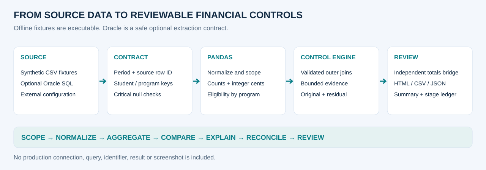

# End-to-end architecture

[Home](../README.md) · [Deep dive](interview_deep_dive.md)



## Source boundary

The executable path loads string-typed CSVs from data/synthetic.
An optional Oracle extraction contract shows bound periods and external configuration.
No notebook or control module opens a network connection; the optional example runs only
when explicitly called in an authorized environment.

## Stages and responsibilities

| Stage | Module | Check / evidence |
|---|---|---|
| Scope and normalize | contracts.py + case adapter | Explicit period, event ID uniqueness, required composite keys |
| Monetary conversion | money.py | Finite decimal input, row-level half-up cents, signed values |
| Eligibility / aggregation | controls.py | Domain-specific universe, counts, unique program rules |
| Bidirectional comparison | reconciliation.py | Outer one_to_one summaries, presence indicator, immutable original deltas |
| Explanation | reconciliation.py | Unique evidence IDs, direction checks, bounded capacity |
| Conservation | reconciliation.py | Pre-join totals = detail + explicitly unassigned |
| Review | reporting.py | Separate math/review states, summary, CSV/HTML and trace |
| Trace | trace.py | Ordered metadata events and optional logger output |

Control functions copy frames before transformation and return a ControlResult.
The result carries detail, allocations, unassigned records, KPIs and a stage ledger.
No source records or connection parameters are logged.

## Relationship contracts

Source row_id is unique within each file before period selection.
Aggregations produce one student/program row; the engine outer-merges with one_to_one.
Scholarship rule lookup uses many_to_one and fails on absent or duplicate configuration.
Count enrichment and final theoretical metadata joins use one_to_one.

## Accounting identities

For lines and integer cents, the sign is actual minus expected:

```text
mother difference = pre-join actual total − pre-join expected total
detail difference = sum of original deltas at student/program grain
unallocated = mother difference − detail difference
mother difference = detail difference + explicitly unassigned source amounts
original delta = signed justified allocation + signed pending residual
```

detail_reconciles requires zero unallocated lines and at most one cent unallocated.
totals_bridge_reconciles requires exact conservation after including the unassigned ledger.
control_clear additionally requires no pending cases and no unassigned rows.
These flags answer different questions.

## Reproducibility and presentation

The synthetic period is 2030-09. Empty valid periods return empty scopes.
Money policy is row half-up to cents, rate half-up once per key, default tolerance one cent.
New notebooks include synthetic executed outputs, scrubbed metadata and independently asserted
results. They expose intermediate aggregation, deliberate contract failure, evidence and bridges.
Assets are generated from the same result objects; no hand-entered screenshot totals are used.

CI runs tests, notebooks, asset generation, links and public-text scanning on Python 3.11/3.12.
Oracle SQL is an example, not an integration test.
