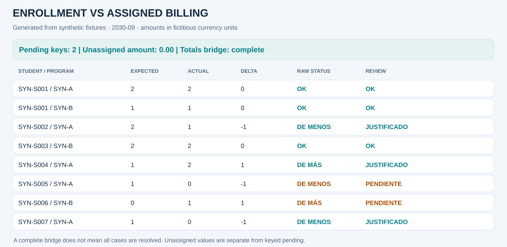
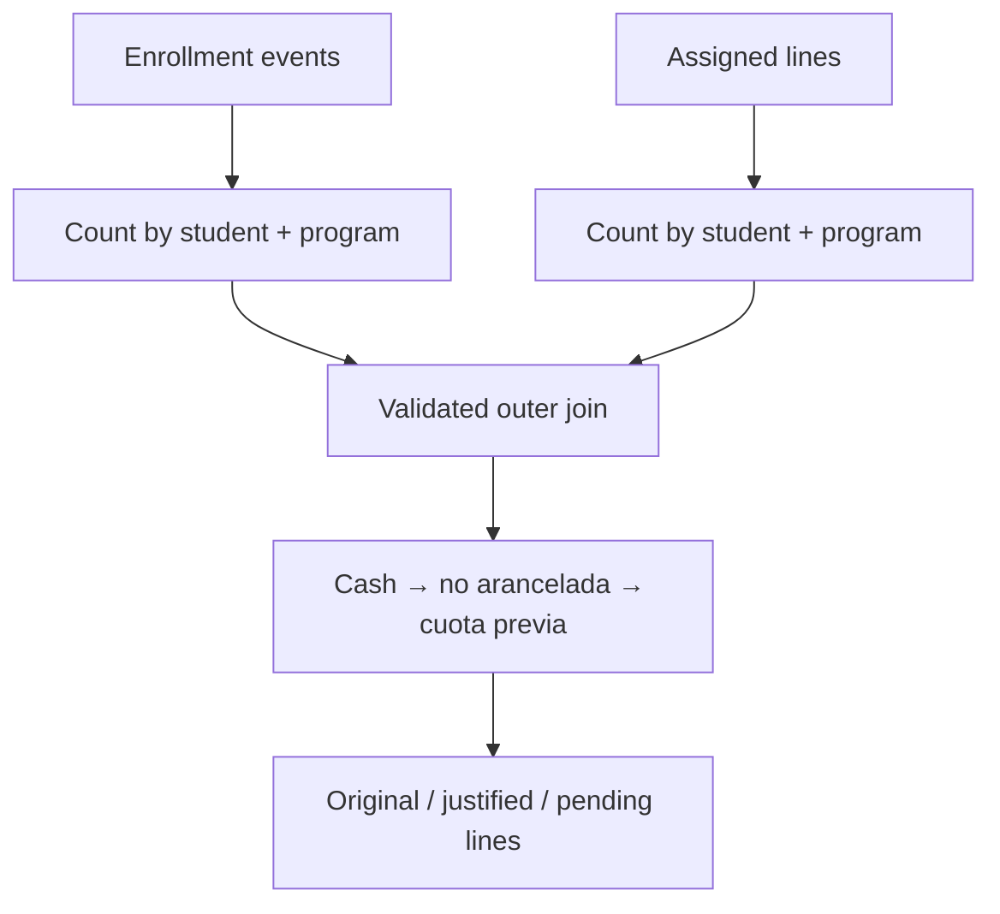

# Inscripciones vs conceptos asignados

[English](01_enrollment.md) · [Notebook ejecutado](../../notebooks/01_enrollment_vs_assigned.ipynb) · [Portfolio](../../README.es.md)

## Problema de negocio y decisión
Las inscripciones académicas y la preparación de facturación pertenecen a universos operativos distintos. Un faltante puede dejar actividad fuera del circuito de cobro; un exceso puede indicar un alcance incorrecto. El total general no identifica qué alumno/carrera requiere revisión.

**Alcance:** período explícito 2030-09, moneda ficticia y referencias inventadas.
**Grano final:** una fila por alumno/carrera. El período se filtra antes de comparar.
Todos los resultados siguientes son sintéticos.

## Fuentes y contratos
enrollments.csv (eventos académicos), assigned.csv (líneas asignadas) y cash.csv (eventos justificantes ficticios). Cada fila tiene ID único y período explícito.

Las claves críticas no admiten vacíos. Los identificadores se conservan como texto. Los eventos
duplicados fallan antes de agregar y los joins declaran cardinalidad.
El dinero se convierte half-up a centavos por evento; las tasas se redondean una vez por clave.
Los nulos de entrada no se reemplazan globalmente por cero.

## Pipeline y transformaciones
1. Validar IDs, claves, períodos y campos Y/N.
2. Filtrar las tres fuentes a 2030-09.
3. Contar filas por alumno/carrera; no es un conteo de materias distintas.
4. Cruzar ambos resúmenes con outer y validación one_to_one.
5. Consumir contado, no aranceladas y cuotas previas en orden definido.
6. Conservar diferencia original, asignación firmada y líneas pendientes.

## Reglas y excepciones
Contado y filas explícitamente no aranceladas pueden explicar asignaciones faltantes (dirección negativa). Las asignaciones marcadas prior_period pueden explicar excesos (dirección positiva). La capacidad nunca supera el remanente. Un indicador arancelario nulo se rechaza.

El signo es real menos esperado. El estado matemático y el de revisión son independientes:
justificar no elimina la diferencia original.

## Ejemplos de revisión sintéticos
| Alumno / carrera | Esperado → real | Estado matemático | Revisión / evidencia | Pendiente |
|---|---:|---|---|---:|
| SYN-S001 / SYN-A | 2 → 2 | OK | OK | 0 |
| SYN-S002 / SYN-A | 2 → 1 | DE MENOS | JUSTIFICADO · no arancelada | 0 |
| SYN-S004 / SYN-A | 1 → 2 | DE MÁS | JUSTIFICADO · cuota previa | 0 |
| SYN-S005 / SYN-A | 1 → 0 | DE MENOS | PENDIENTE | −1 |
| SYN-S006 / SYN-B | 0 → 1 | DE MÁS | PENDIENTE | +1 |

## Conciliación y métricas
9 asignadas − 10 inscriptas = −1 línea neta = suma de diferencias por clave. Tras justificar, las líneas pendientes netean cero, pero suman 2 en valor absoluto. Por eso siguen existiendo dos claves pendientes.

El notebook muestra etapas, resumen de estados, asignaciones, totales de origen,
diferencias firmadas y pendientes absolutos. Casos por alumno/carrera y alumnos distintos
son métricas diferentes.

## Outputs y reproducción
[HTML de revisión](../outputs/01_enrollment/report.html) ·
[Resumen de estados](../outputs/01_enrollment/summary.csv) ·
[Etapas](../outputs/01_enrollment/trace.csv) ·
[Métricas](../outputs/01_enrollment/kpis.json).

Descargar y abrir el HTML localmente; GitHub muestra su código.
Ejecutar `python -m financial_controls.demo --period 2030-09 --output artifacts` desde la raíz.
El [adaptador](../../src/financial_controls/controls.py) aporta la lógica de negocio al
[motor compartido](../../src/financial_controls/reconciliation.py).

## Riesgos y límites
Igual cantidad puede ocultar materias distintas dentro de la clave. La evidencia agregada no prueba qué materia quedó cubierta. prior_period es un contrato ficticio, no un algoritmo productivo de detección de fechas.

La fixture no certifica exactitud productiva, aprobación de excepciones ni impacto económico.

## Preguntas de entrevista
- ¿Por qué usar clave compuesta en lugar del total por alumno?
- ¿Por qué un neto pendiente cero requiere revisión?
- ¿Cuándo corresponde pasar a un matching exacto por materia?
