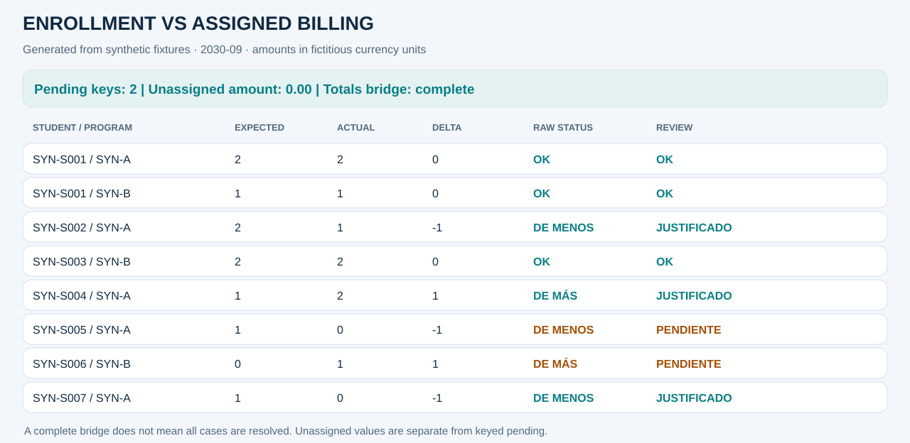
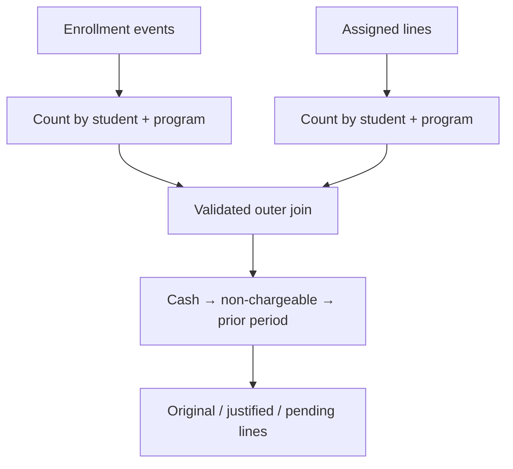

# Enrollment vs assigned billing

[Español](01_enrollment.es.md) · [Executed notebook](../../notebooks/01_enrollment_vs_assigned.ipynb) · [Portfolio](../../README.md)

## Business problem and decision
Academic enrollment and billing preparation are separate operational universes. Missing assignments can leave activity outside billing; extra assignments can indicate an incorrect scope. A grand total cannot show which student/program needs review.

**Scope:** one explicit period (2030-09), fictitious currency and invented student/program references.
**Final grain:** one row per student + program. Period is selected before comparison.
All results below are synthetic.

## Sources and contracts
enrollments.csv (academic events), assigned.csv (assigned lines), cash.csv (synthetic explanatory events). All rows have a unique event ID and explicit period.

Critical keys cannot be blank. Identifiers remain strings. Source-row duplicates fail before
aggregation; summarized joins declare cardinality. The monetary policy is integer cents after
row-level half-up conversion; benefit rates round once per key. No blanket fillna(0) is used on inputs.

## Pipeline and transformations
1. Validate event IDs, keys, periods and Y/N fields.
2. Scope all three sources to 2030-09.
3. Count rows at student + program grain; this is not a distinct-subject count.
4. Outer-join expected enrollment and actual assignment summaries with one_to_one validation.
5. Consume cash, non-chargeable and prior-period capacities in defined priority order.
6. Preserve original differences, signed allocations and residual lines.

## Rules and exceptions
Cash and explicitly non-chargeable rows can explain missing assignments (negative direction). Assigned rows marked prior_period can explain extra assignments (positive direction). Capacity never exceeds the residual. Null chargeability is rejected rather than interpreted as a free subject.

The sign convention is actual minus expected. Raw mathematical status and review status are
separate: explaining a difference never erases the original delta.

## Synthetic review examples
| Student / program | Expected → actual | Raw status | Review status / evidence | Pending |
|---|---:|---|---|---:|
| SYN-S001 / SYN-A | 2 → 2 | OK | OK | 0 |
| SYN-S002 / SYN-A | 2 → 1 | DE MENOS | JUSTIFICADO · non-chargeable | 0 |
| SYN-S004 / SYN-A | 1 → 2 | DE MÁS | JUSTIFICADO · prior period | 0 |
| SYN-S005 / SYN-A | 1 → 0 | DE MENOS | PENDIENTE | −1 |
| SYN-S006 / SYN-B | 0 → 1 | DE MÁS | PENDIENTE | +1 |

## Reconciliation and metrics
9 assigned − 10 enrollment = −1 net line = sum of keyed differences. After explanations, pending lines net to zero but their absolute sum is 2. Two unresolved keys therefore remain despite a zero pending net.

The notebook displays the complete stage ledger, status summary, allocation details, source
totals, signed differences and absolute residuals. Case counts refer to student/program keys;
distinct students and cases are different metrics.

## Outputs and reproducibility
[HTML review source](../outputs/01_enrollment/report.html) ·
[Status summary](../outputs/01_enrollment/summary.csv) ·
[Stage ledger](../outputs/01_enrollment/trace.csv) ·
[KPIs](../outputs/01_enrollment/kpis.json).

Open downloaded HTML locally for the dashboard; GitHub shows HTML source.
Run `python -m financial_controls.demo --period 2030-09 --output artifacts` from the root.
The [adapter](../../src/financial_controls/controls.py) supplies domain logic to the
[shared engine](../../src/financial_controls/reconciliation.py).

## Risks and limits
Equal counts can hide different subjects inside the same key. Aggregate evidence does not prove which subject was covered. A prior-period flag is a synthetic contract, not a production date-detection algorithm.

The fixture does not certify production accuracy, approval of exceptions or financial impact.

## Interview questions
- Why is a composite key safer than a student-only total?
- Why does a zero pending net still require review?
- When should this become exact subject-level matching?
