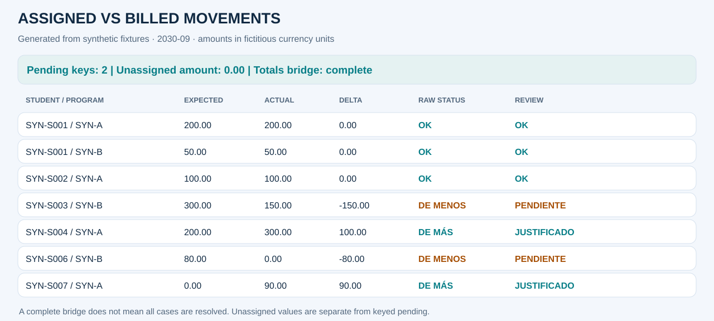
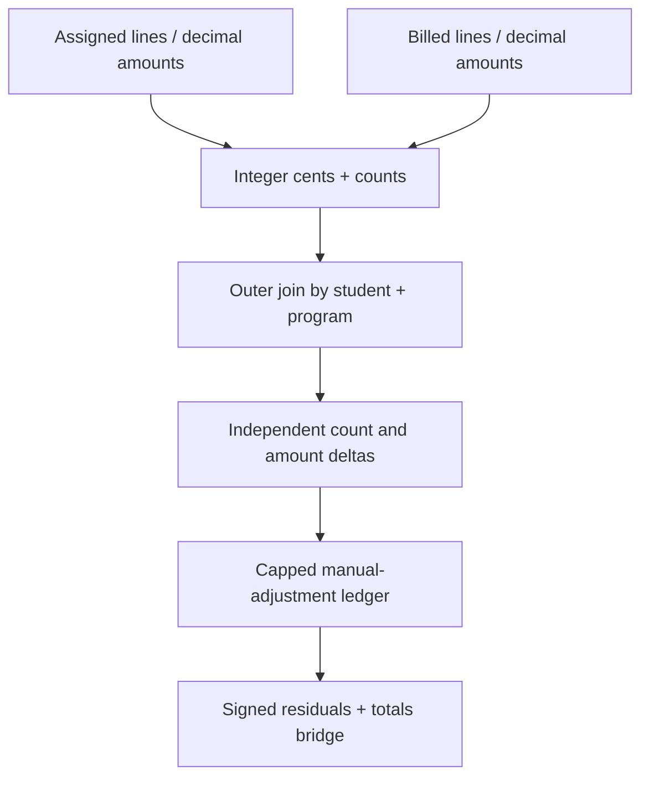

# Conceptos asignados vs movimientos facturados

[English](02_billing.md) · [Notebook ejecutado](../../notebooks/02_assigned_vs_billed.ipynb) · [Portfolio](../../README.es.md)

## Problema de negocio y decisión
Preparar la facturación no garantiza que cada línea haya sido facturada con el importe esperado. Este control compara cantidades y valor, detecta faltantes y movimientos inesperados, y separa ajustes explicables de exposición pendiente.

**Alcance:** período explícito 2030-09, moneda ficticia y referencias inventadas.
**Grano final:** una fila por alumno/carrera. El período se filtra antes de comparar.
Todos los resultados siguientes son sintéticos.

## Fuentes y contratos
assigned.csv (líneas/importes esperados) y billed.csv (movimientos reales, con bandera ficticia manual_adjustment). Cada fila representa una línea financiera, no el saldo de un alumno.

Las claves críticas no admiten vacíos. Los identificadores se conservan como texto. Los eventos
duplicados fallan antes de agregar y los joins declaran cardinalidad.
El dinero se convierte half-up a centavos por evento; las tasas se redondean una vez por clave.
Los nulos de entrada no se reemplazan globalmente por cero.

## Pipeline y transformaciones
1. Validar IDs de eventos y claves compuestas antes de agrupar.
2. Convertir decimales, redondear cada evento half-up a centavos y conservar signos.
3. Agregar cantidad de líneas y centavos firmados por alumno/carrera.
4. Cruzar resúmenes con outer y validación one_to_one.
5. Evaluar diferencias de importe y cantidad por separado, incluso diferencias sólo de cantidad.
6. Aplicar evidencia acotada de ajustes manuales y exponer remanentes.

## Reglas y excepciones
Sólo las filas sintéticas de ajuste manual explican excesos facturados. Las capacidades de cantidad e importe se limitan por separado; cerrar una dimensión no cierra la otra. Los faltantes quedan pendientes. Una capacidad de ajuste negativa requiere revisión explícita.

El signo es real menos esperado. El estado matemático y el de revisión son independientes:
justificar no elimina la diferencia original.

## Ejemplos de revisión sintéticos
| Alumno / carrera | Esperado → real | Estado matemático | Revisión / evidencia | Pendiente |
|---|---:|---|---|---:|
| SYN-S001 / SYN-A | 200.00 → 200.00 | OK | OK | 0.00 |
| SYN-S003 / SYN-B | 300.00 → 150.00 | DE MENOS | PENDIENTE | −150.00 |
| SYN-S004 / SYN-A | 200.00 → 300.00 | DE MÁS | JUSTIFICADO · ajuste manual | 0.00 |
| SYN-S006 / SYN-B | 80.00 → 0.00 | DE MENOS | PENDIENTE | −80.00 |
| SYN-S007 / SYN-A | 0.00 → 90.00 | DE MÁS | JUSTIFICADO · ajuste manual | 0.00 |

## Conciliación y métricas
Ambas fuentes contienen 9 líneas, pero 890,00 reales − 930,00 esperados = −40,00. Los ajustes positivos justificados suman 190,00 y los faltantes pendientes −230,00. Por eso −40,00 = +190,00 − 230,00. Igual cantidad total no implica claves correctas.

El notebook muestra etapas, resumen de estados, asignaciones, totales de origen,
diferencias firmadas y pendientes absolutos. Casos por alumno/carrera y alumnos distintos
son métricas diferentes.

## Outputs y reproducción
[HTML de revisión](../outputs/02_billing/report.html) ·
[Resumen de estados](../outputs/02_billing/summary.csv) ·
[Etapas](../outputs/02_billing/trace.csv) ·
[Métricas](../outputs/02_billing/kpis.json).

Descargar y abrir el HTML localmente; GitHub muestra su código.
Ejecutar `python -m financial_controls.demo --period 2030-09 --output artifacts` desde la raíz.
El [adaptador](../../src/financial_controls/controls.py) aporta la lógica de negocio al
[motor compartido](../../src/financial_controls/reconciliation.py).

## Riesgos y límites
Importes y cantidades son señales agregadas, no matching exacto de facturas. La bandera ficticia no prueba aprobación de un ajuste productivo. Las direcciones contradictorias se señalan. Se usa una moneda ficticia.

La fixture no certifica exactitud productiva, aprobación de excepciones ni impacto económico.

## Preguntas de entrevista
- ¿Por qué comparar cantidades si el importe concilia?
- ¿Cómo se evita que evidencia parcial justifique de más?
- ¿Qué claves adicionales permitirían matching por factura?
