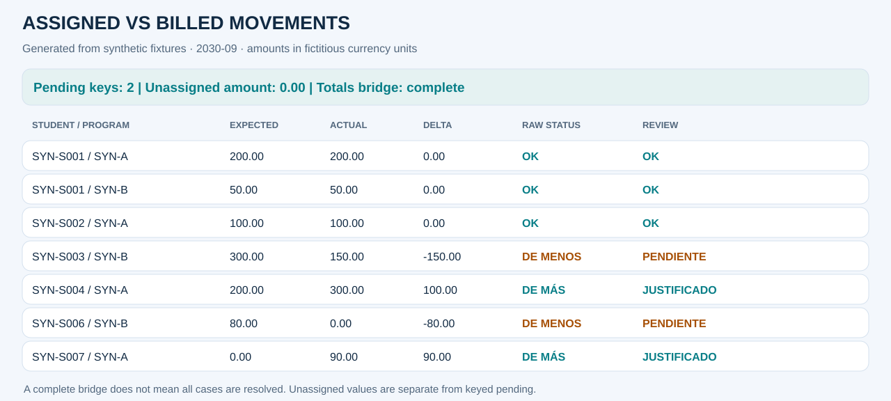
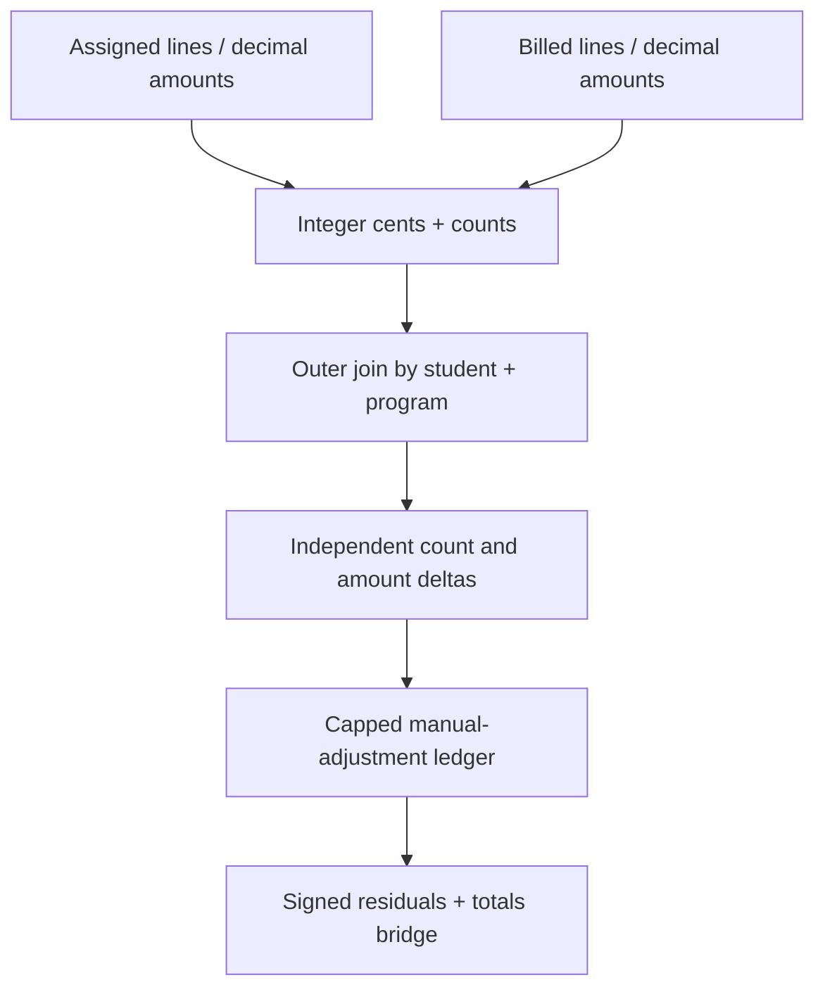

# Assigned concepts vs billed movements

[Español](02_billing.es.md) · [Executed notebook](../../notebooks/02_assigned_vs_billed.ipynb) · [Portfolio](../../README.md)

## Business problem and decision
Billing preparation does not guarantee that every line was posted at the expected amount. This control compares both quantities and value, detects missing billing and unexpected movements, and separates explainable adjustments from unresolved exposure.

**Scope:** one explicit period (2030-09), fictitious currency and invented student/program references.
**Final grain:** one row per student + program. Period is selected before comparison.
All results below are synthetic.

## Sources and contracts
assigned.csv (expected lines/amounts) and billed.csv (actual posted lines/amounts, with a fictitious manual_adjustment flag). One row represents one financial line, not a student balance.

Critical keys cannot be blank. Identifiers remain strings. Source-row duplicates fail before
aggregation; summarized joins declare cardinality. The monetary policy is integer cents after
row-level half-up conversion; benefit rates round once per key. No blanket fillna(0) is used on inputs.

## Pipeline and transformations
1. Validate source event IDs and composite keys before aggregation.
2. Parse decimal strings, half-up round each event to cents, and preserve accounting signs.
3. Aggregate line counts and signed cents by student/program.
4. Outer-join summaries with one_to_one validation.
5. Evaluate amount and count differences independently, including count-only discrepancies.
6. Allocate bounded synthetic manual-adjustment evidence and expose residuals.

## Rules and exceptions
Only synthetic manual-adjustment rows explain excess actual billing. Line and amount capacities are capped independently; closing one dimension does not close the other. Missing billed amounts remain pending. Negative adjustment capacity is rejected for explicit review.

The sign convention is actual minus expected. Raw mathematical status and review status are
separate: explaining a difference never erases the original delta.

## Synthetic review examples
| Student / program | Expected → actual | Raw status | Review status / evidence | Pending |
|---|---:|---|---|---:|
| SYN-S001 / SYN-A | 200.00 → 200.00 | OK | OK | 0.00 |
| SYN-S003 / SYN-B | 300.00 → 150.00 | DE MENOS | PENDIENTE | −150.00 |
| SYN-S004 / SYN-A | 200.00 → 300.00 | DE MÁS | JUSTIFICADO · manual adjustment | 0.00 |
| SYN-S006 / SYN-B | 80.00 → 0.00 | DE MENOS | PENDIENTE | −80.00 |
| SYN-S007 / SYN-A | 0.00 → 90.00 | DE MÁS | JUSTIFICADO · manual adjustment | 0.00 |

## Reconciliation and metrics
Both sources contain 9 lines, but 890.00 actual − 930.00 expected = −40.00. Positive justified adjustments total 190.00; unresolved shortages total −230.00. Thus −40.00 = +190.00 − 230.00. Equal line totals do not make the individual keys correct.

The notebook displays the complete stage ledger, status summary, allocation details, source
totals, signed differences and absolute residuals. Case counts refer to student/program keys;
distinct students and cases are different metrics.

## Outputs and reproducibility
[HTML review source](../outputs/02_billing/report.html) ·
[Status summary](../outputs/02_billing/summary.csv) ·
[Stage ledger](../outputs/02_billing/trace.csv) ·
[KPIs](../outputs/02_billing/kpis.json).

Open downloaded HTML locally for the dashboard; GitHub shows HTML source.
Run `python -m financial_controls.demo --period 2030-09 --output artifacts` from the root.
The [adapter](../../src/financial_controls/controls.py) supplies domain logic to the
[shared engine](../../src/financial_controls/reconciliation.py).

## Risks and limits
Amounts and counts are aggregate signals, not exact invoice matching. The synthetic flag does not prove a production adjustment was approved. Mixed line/amount directions are flagged. All examples use one fictitious currency.

The fixture does not certify production accuracy, approval of exceptions or financial impact.

## Interview questions
- Why compare line count when amounts already reconcile?
- How is partial evidence prevented from overjustifying a difference?
- What additional keys would support invoice-level matching?
