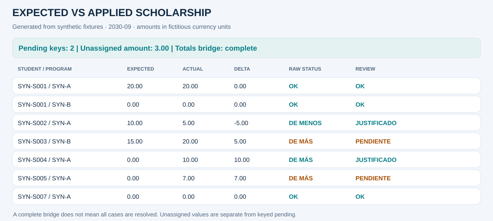
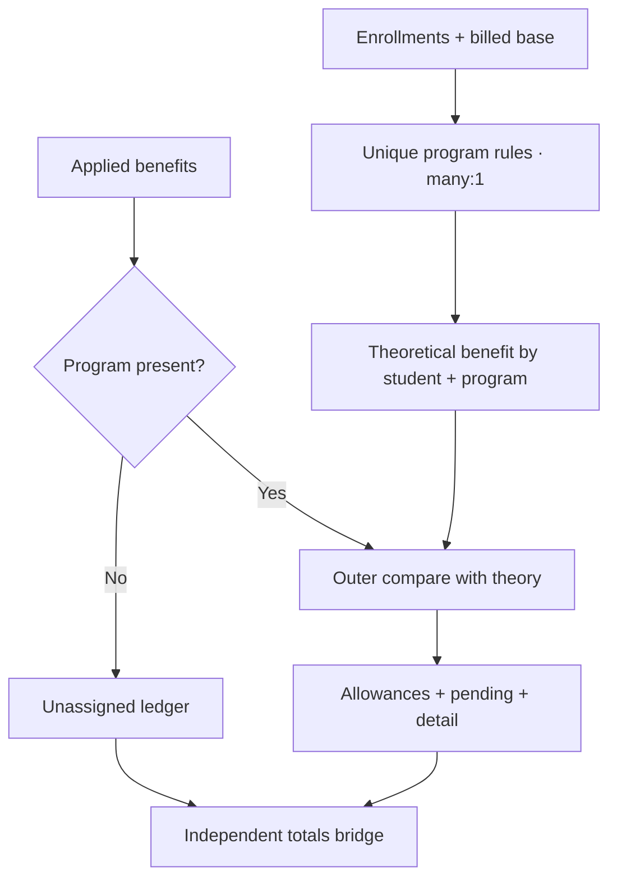

# Beca teórica vs beca aplicada

[English](03_scholarship.md) · [Notebook ejecutado](../../notebooks/03_expected_vs_applied_scholarship.ipynb) · [Portfolio](../../README.es.md)

## Problema de negocio y decisión
Un beneficio puede aplicarse sin elegibilidad, omitirse cuando corresponde o registrarse sin carrera. Este control deriva la beca teórica desde inscripciones y base facturada, compara lo aplicado y hace visibles los problemas de atribución.

**Alcance:** período explícito 2030-09, moneda ficticia y referencias inventadas.
**Grano final:** una fila por alumno/carrera. El período se filtra antes de comparar.
Todos los resultados siguientes son sintéticos.

## Fuentes y contratos
enrollments.csv, billed.csv, scholarship_rules.csv, scholarships.csv y scholarship_exceptions.csv. Los eventos tienen IDs únicos. Las reglas son únicas por período/carrera. Una beca aplicada puede carecer de carrera y se deriva fuera del detalle por clave.

Las claves críticas no admiten vacíos. Los identificadores se conservan como texto. Los eventos
duplicados fallan antes de agregar y los joins declaran cardinalidad.
El dinero se convierte half-up a centavos por evento; las tasas se redondean una vez por clave.
Los nulos de entrada no se reemplazan globalmente por cero.

## Pipeline y transformaciones
1. Validar y filtrar entradas; contar inscripciones y sumar centavos facturados por clave.
2. Incorporar reglas many_to_one y cantidades one_to_one. La configuración faltante produce error.
3. Aplicar mínimo ficticio de dos materias y 10%; redondear half-up por clave.
4. Derivar becas sin carrera al registro no asignado.
5. Cruzar teórico y aplicado con outer, conservando aplicados sin base teórica.
6. Aplicar asignaciones ficticias explícitas y reconstruir el total aplicado desde detalle más no asignados.

## Reglas y excepciones
Las constantes de elegibilidad y los dos importes justificantes son ficticios. El aplicado usa convención positiva; valores negativos fallan en lugar de convertirse silenciosamente a positivos. Las asignaciones por no arancelada y beneficio especial explican sólo su capacidad declarada.

El signo es real menos esperado. El estado matemático y el de revisión son independientes:
justificar no elimina la diferencia original.

## Ejemplos de revisión sintéticos
| Alumno / carrera | Esperado → real | Estado matemático | Revisión / evidencia | Pendiente |
|---|---:|---|---|---:|
| SYN-S001 / SYN-A | 20.00 → 20.00 | OK | OK | 0.00 |
| SYN-S002 / SYN-A | 10.00 → 5.00 | DE MENOS | JUSTIFICADO · asignación ficticia | 0.00 |
| SYN-S003 / SYN-B | 15.00 → 20.00 | DE MÁS | PENDIENTE | +5.00 |
| SYN-S004 / SYN-A | 0.00 → 10.00 | DE MÁS | JUSTIFICADO · beneficio especial | 0.00 |
| SYN-S005 / SYN-A | 0.00 → 7.00 | DE MÁS | PENDIENTE · aplicado sin base | +7.00 |

## Conciliación y métricas
65,00 aplicados − 45,00 teóricos = +20,00. El detalle explica +17,00 y el registro sin carrera +3,00. El puente completo concilia; el detalle solo no. El pendiente por clave neto y absoluto es 12,00, más 3,00 no asignados informados aparte.

El notebook muestra etapas, resumen de estados, asignaciones, totales de origen,
diferencias firmadas y pendientes absolutos. Casos por alumno/carrera y alumnos distintos
son métricas diferentes.

## Outputs y reproducción
[HTML de revisión](../outputs/03_scholarship/report.html) ·
[Resumen de estados](../outputs/03_scholarship/summary.csv) ·
[Etapas](../outputs/03_scholarship/trace.csv) ·
[Métricas](../outputs/03_scholarship/kpis.json).

Descargar y abrir el HTML localmente; GitHub muestra su código.
Ejecutar `python -m financial_controls.demo --period 2030-09 --output artifacts` desde la raíz.
El [adaptador](../../src/financial_controls/controls.py) aporta la lógica de negocio al
[motor compartido](../../src/financial_controls/reconciliation.py).

## Riesgos y límites
El universo teórico nace de la base facturada, no de todos los potencialmente elegibles. El outer conserva becas aplicadas sin base, pero no infiere una beca para alguien elegible sin base facturada. No se distribuyen automáticamente importes sin carrera.

La fixture no certifica exactitud productiva, aprobación de excepciones ni impacto económico.

## Preguntas de entrevista
- ¿Por qué no sumar la beca sin carrera a todas las carreras?
- ¿Qué diferencia hay entre detail_reconciles y totals_bridge_reconciles?
- ¿Por qué rechazar configuración faltante en lugar de asumir un mínimo?
