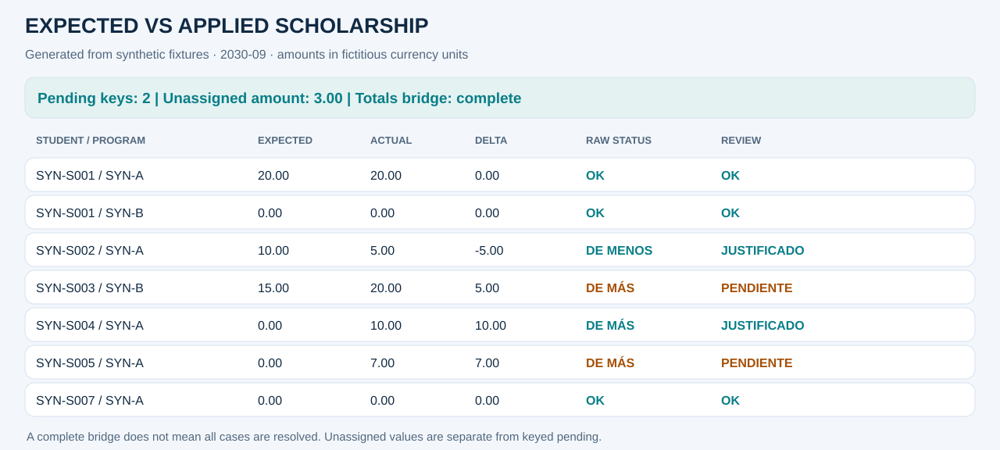
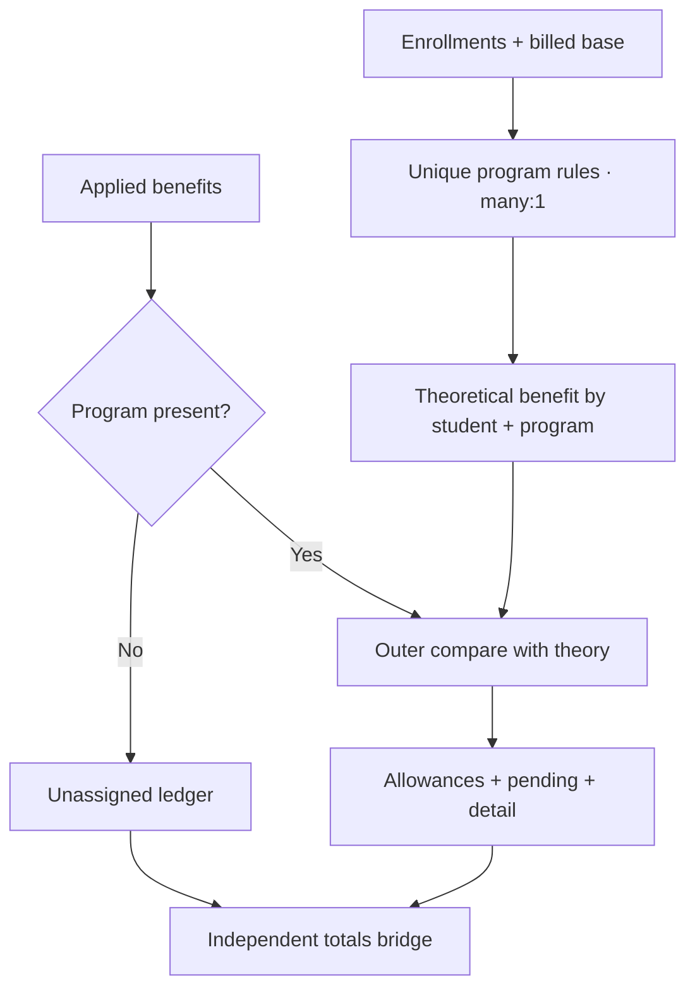

# Expected vs applied scholarship

[Español](03_scholarship.es.md) · [Executed notebook](../../notebooks/03_expected_vs_applied_scholarship.ipynb) · [Portfolio](../../README.md)

## Business problem and decision
A benefit may be applied even when eligibility is not met, missed when due, or recorded without a program. This control derives a theoretical benefit from enrollment and billed base, compares the applied amount, and makes attribution gaps visible.

**Scope:** one explicit period (2030-09), fictitious currency and invented student/program references.
**Final grain:** one row per student + program. Period is selected before comparison.
All results below are synthetic.

## Sources and contracts
enrollments.csv, billed.csv, scholarship_rules.csv, scholarships.csv and scholarship_exceptions.csv. Event inputs have unique row IDs. Rules are unique by selected period/program. Applied benefit may have a missing program, deliberately routed outside keyed detail.

Critical keys cannot be blank. Identifiers remain strings. Source-row duplicates fail before
aggregation; summarized joins declare cardinality. The monetary policy is integer cents after
row-level half-up conversion; benefit rates round once per key. No blanket fillna(0) is used on inputs.

## Pipeline and transformations
1. Validate and scope inputs; count enrollment and aggregate billed cents by composite key.
2. Join rules many_to_one and enrollment counts one_to_one. Missing configuration fails.
3. Apply the fictitious minimum of two subjects and 10% rate; half-up round per key.
4. Route missing-program applied benefits to an unassigned ledger.
5. Outer-join theory and keyed applied amounts; retain applied-only keys.
6. Allocate explicit synthetic allowances and bridge detail plus unassigned back to original applied totals.

## Rules and exceptions
Eligibility constants and the two allowance amounts are fictional. Applied benefits use a positive convention; negative values fail rather than being silently made positive. The non-chargeable allowance and special benefit explain only their declared capacity, not the entire student's discrepancy.

The sign convention is actual minus expected. Raw mathematical status and review status are
separate: explaining a difference never erases the original delta.

## Synthetic review examples
| Student / program | Expected → actual | Raw status | Review status / evidence | Pending |
|---|---:|---|---|---:|
| SYN-S001 / SYN-A | 20.00 → 20.00 | OK | OK | 0.00 |
| SYN-S002 / SYN-A | 10.00 → 5.00 | DE MENOS | JUSTIFICADO · synthetic allowance | 0.00 |
| SYN-S003 / SYN-B | 15.00 → 20.00 | DE MÁS | PENDIENTE | +5.00 |
| SYN-S004 / SYN-A | 0.00 → 10.00 | DE MÁS | JUSTIFICADO · special benefit | 0.00 |
| SYN-S005 / SYN-A | 0.00 → 7.00 | DE MÁS | PENDIENTE · applied-only key | +7.00 |

## Reconciliation and metrics
65.00 applied − 45.00 theoretical = +20.00. Keyed differences explain +17.00 and the missing-program ledger holds +3.00. The complete bridge reconciles; keyed detail alone does not. Pending keyed net and absolute values are both 12.00, plus a separately reported unassigned 3.00.

The notebook displays the complete stage ledger, status summary, allocation details, source
totals, signed differences and absolute residuals. Case counts refer to student/program keys;
distinct students and cases are different metrics.

## Outputs and reproducibility
[HTML review source](../outputs/03_scholarship/report.html) ·
[Status summary](../outputs/03_scholarship/summary.csv) ·
[Stage ledger](../outputs/03_scholarship/trace.csv) ·
[KPIs](../outputs/03_scholarship/kpis.json).

Open downloaded HTML locally for the dashboard; GitHub shows HTML source.
Run `python -m financial_controls.demo --period 2030-09 --output artifacts` from the root.
The [adapter](../../src/financial_controls/controls.py) supplies domain logic to the
[shared engine](../../src/financial_controls/reconciliation.py).

## Risks and limits
The theoretical universe starts from billed base, not all potentially eligible students. The outer comparison catches applied-only benefits, but cannot infer a benefit for an eligible student with no billed base. No automatic allocation of missing-program benefits is attempted.

The fixture does not certify production accuracy, approval of exceptions or financial impact.

## Interview questions
- Why is a missing-program benefit not added to every program?
- What is the difference between detail_reconciles and totals_bridge_reconciles?
- Why reject a missing rule instead of assuming a default minimum?
