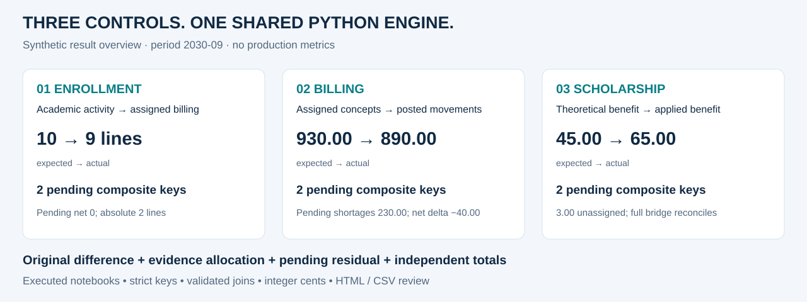

# Recorrido del portfolio · un minuto

[English](portfolio_walkthrough.md) · [Inicio](../README.es.md)

**Foco de negocio:** hacer consistentes los datos académicos y financieros antes de que las
diferencias se conviertan en excepciones difíciles de explicar. Se reconstruyen tres patrones
de controles profesionales con datos inventados, sin acceso a sistemas institucionales.

## 0–20 segundos · entender el alcance

| Control | Pregunta de negocio | Ejemplo sintético |
|---|---|---|
| [Inscripciones](cases/01_enrollment.es.md) | ¿La actividad académica está representada en la preparación de facturación? | Excesos y faltantes visibles aunque el neto pendiente se compense |
| [Facturación](cases/02_billing.es.md) | ¿Se facturaron correctamente las líneas asignadas? | 9 líneas en cada fuente dejan 230,00 de faltantes pendientes |
| [Becas](cases/03_scholarship.es.md) | ¿Se aplicó el beneficio correcto a la carrera correcta? | 3,00 sin carrera quedan separados y no se duplican |

## 20–40 segundos · identificar el aporte

El trabajo combina reglas de negocio con ingeniería en Python/Pandas: definir el universo,
normalizar identificadores, validar joins, comparar cantidades e importes, justificar sólo lo
respaldado por evidencia y reconstruir totales de origen. Jupyter permite revisar las decisiones;
HTML y CSV permiten gestionar los resultados fuera del notebook.

## 40–60 segundos · mirar evidencia

Abrir el [notebook ejecutado de becas](../notebooks/03_expected_vs_applied_scholarship.ipynb):
muestra teoría, aplicado sin base, registro sin carrera y conciliación independiente.
Cada caso tiene notebook, vista de resultados, reglas, riesgos y preguntas de entrevista.

**Se demuestra:** diseño de controles, joins y agregaciones, contratos de extracción Oracle,
manejo monetario, análisis de excepciones y verificaciones automatizadas.
**No se afirma:** plataforma productiva certificada, migración completa, ahorro medido
ni cifras de cobertura o volumen no verificadas.

Continuar con la [profundización para entrevistas técnicas](interview_deep_dive.es.md).
