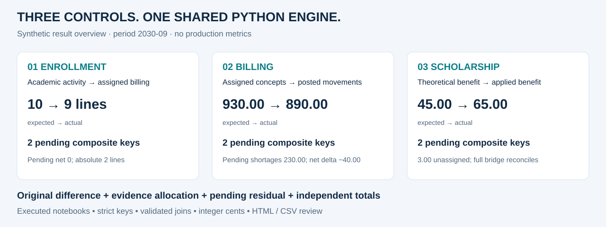

# Portfolio walkthrough · one minute

[Español](portfolio_walkthrough.es.md) · [Home](../README.md)

**Business focus:** make academic and financial data agree before differences become opaque
operational exceptions. Three professional control patterns are rebuilt with invented data;
the portfolio makes the analysis reproducible without access to institutional systems.

## 0–20 seconds · see the scope

| Control | Business question | Synthetic example |
|---|---|---|
| [Enrollment](cases/01_enrollment.md) | Is academic activity represented in billing preparation? | Missing and extra assignments remain visible even when pending totals offset |
| [Billing](cases/02_billing.md) | Were assigned lines billed correctly? | 9 lines on each side still leave 230.00 of unresolved keyed shortages |
| [Scholarship](cases/03_scholarship.md) | Was the correct benefit applied to the correct program? | 3.00 without a program stays separate instead of being duplicated |

## 20–40 seconds · understand the contribution

The work combines domain rules with Python/Pandas engineering: define the universe, normalize
identifiers, validate joins, compare quantities and amounts, explain only what evidence supports,
and reconcile the detail to independent source totals. Jupyter makes these decisions inspectable;
HTML and CSV make the output reviewable outside the notebook.

## 40–60 seconds · inspect the evidence

Open the [executed scholarship notebook](../notebooks/03_expected_vs_applied_scholarship.ipynb)
to see theory, applied-only records, the missing-program ledger and the totals bridge.
Each case has its own notebook, result snapshot, rules, risks and interview questions.

**What is demonstrated:** control design, Pandas joins and aggregation, Oracle extraction
contracts, monetary handling, exception analysis and automated checks.
**What is not claimed:** a certified production platform, completed migration, measured savings,
or unverified coverage and volume figures.

Continue with the [technical interview deep dive](interview_deep_dive.md).
